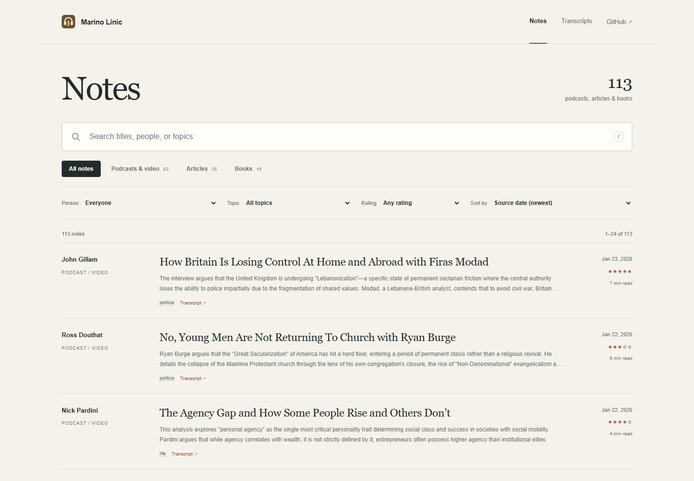
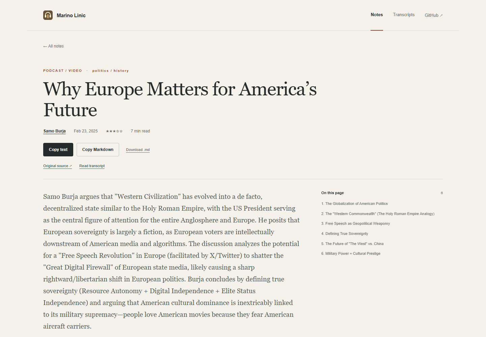
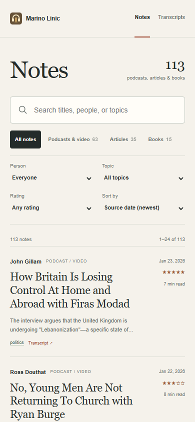

# Marino's Notes


A searchable library of 113 notes on podcasts, articles, and books. Original Markdown is the editable source. A small Node build renders the site, text exports and source links. No Jekyll, Ruby, duplicated note collection or manual conversion step is required.

[Read the published library](https://marinolinic.github.io/podcasts/)



| Note reader | Phone library |
| --- | --- |
|  |  |

## Edit or add a note

Edit a file in `notes/`, or add `Author - Title.md`. Commit and push to `main`; GitHub Actions builds and publishes it. There is no converted Markdown copy to update. Existing `/podcasts/notes/<slug>/` URLs retain the earlier filename rule.

```markdown
Summary:
A short summary of the source.

Rating: 4
Type: video
Tags: history, politics
Date: 14 Nov 2026
Source: https://www.youtube.com/watch?v=VIDEO_ID

---

## First section
Your notes.
```

Type accepts `video`, `article`, or `book`. Metadata is optional; unknown dates and ratings stay unknown. Dates describe the source, not file creation. Keep exact source URLs. Renaming a file changes its note URL.

## Read and copy

Search titles, people, summaries and topics. Filter by source type, person, topic or rating; sort by date, title, person or rating. The library renders 24 results per page. Filters/page numbers survive reload through the URL. Notes have local contents lists instead of a sidebar listing every note.

- **Copy text** gives readable plain text for a Facebook post, message or document, retaining the title and source links.
- **Copy Markdown** gives the exact original source text, including metadata and formatting.
- **Download .md** preserves original bytes. Denied clipboard access opens a selectable-text fallback.

Original note wording is retained. Notes are curated by Marino and largely written with Gemini; they are not independently verified source records.

## Local preview

Node.js 22 or newer is required. Dependencies run during building; the published site has no framework runtime or CDN dependency.

```powershell
npm ci --ignore-scripts
npm run dev
```

Open `http://127.0.0.1:4175/podcasts/`. The preview rebuilds when notes, site assets or the caption catalog change. Stop with Ctrl+C. After installation, **Open Notes.cmd** starts or reuses that preview, then opens the browser when ready. Restart the preview after changing build scripts.

```powershell
npm run check
npm run verify:preservation
```

The check runs content/security/preservation/caption tests, builds the site and validates routes/assets and exact Markdown exports. Generated `dist/` is ignored. The builder replaces only its own marked output directory and never modifies notes, sources or legacy material.

## Files

```text
notes/                         Original, editable Markdown
sources/youtube/
  catalog.json                 Identity, note associations, coverage and status
  <video-id>/
    transcript.md              Unchanged caption Markdown returned by yt
    segments.json              Unchanged metadata and timed segments from yt
    source.json                Identity, caption type, language, dates and hashes
site/                          CSS and small browser interactions
scripts/                       Build, checks, preview and caption import
legacy/2026-11-14/              Previous Jekyll pages, exports, transcripts and tools
docs/preservation-manifest.json Original/retained paths, byte sizes and SHA-256
docs/HANDOFF.md                 Current state and continuation
dist/                          Generated Pages artifact; ignored
```

Baby Essentials and Intelligence remain accessible from About as retained standalone pages. Legacy assets/scripts remain archived and are not copied into the active site wholesale.

## YouTube captions

On November 14, 2026, the installed tools-youtube CLI retrieved captions for **all 64 exact video IDs linked by 63 video notes**. One note has a two-part source. Zero requests returned unavailable captions or failed. Captions were downloaded, not transcribed with a paid model. Eight older TXT transcripts remain in `legacy/2026-11-14/Transcripts/`.

Use the installed youtube-tools skill. Prepare a bounded list:

```powershell
node scripts/youtube-sources.mjs list > "C:\Users\marin\agent-files\trash\podcasts-urls.txt"
```

Run `yt transcript` with that list, `--timestamps --save-json --playlist no`, a new explicit output directory under agent-files/trash and `--report <new-report.json>`. Check the result before importing:

```powershell
node scripts/youtube-sources.mjs import "C:\Users\marin\agent-files\trash\NEW-RUN\report.json"
npm run check
```

The importer verifies IDs/nonempty segments, preserves returned bytes and refuses to overwrite differing captions. It never downloads media or obtains cookies. Missing captions and access failures stay distinct. New versions need a separate dated acquisition and deliberate preservation decision. Saved captions do not validate a note's interpretation.

## Publishing and preservation

Pages uses **GitHub Actions**, not the legacy branch/Jekyll builder. `.github/workflows/pages.yml` installs lockfile dependencies, runs checks, uploads only dist and deploys it. `site.config.json` owns the origin and `/podcasts` base path. Direct note URLs, downloads, copy fetches and assets include that prefix.

The November14 reorganization verified all **475 existing files totaling 12,344,104 bytes**, including every original note. The preservation manifest records the result. Immutable legacy checks run in CI; deliberate source-note edits remain allowed. Compare notes against the initial snapshot with `npm run verify:preservation -- --include-notes`. The preexisting ignored font.ttf stays local-only, as before.
