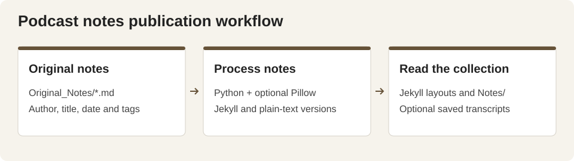

# Podcast Notes

A Jekyll collection of notes on podcasts, articles and books, with an optional Python preprocessing step. Original Markdown notes are retained separately from the versions prepared for the website and plain-text reading.



## Read the collection

The existing configuration targets [Marino's Podcast Notes](https://marinolinic.github.io/podcasts/). Repository notes can also be read directly in a Markdown editor. `index.html` and the layouts use Jekyll frontmatter and Liquid, so opening the source HTML directly does not build the site.

For a local site preview, install Ruby, Jekyll and its dependencies in your own development environment, then run from this directory:

```powershell
jekyll serve
```

The repository does not supply a Gemfile or a locked Ruby environment. Local Jekyll setup is therefore not reproducibly pinned by this project.

## Process original notes

Put authored `.md` files in `Original_Notes/`. Filenames use `Author - Title.md`; the processor reads metadata such as `Date:`, `Rating:`, `Type:` and `Tags:` from the note text. From the root:

```powershell
py process_notes.py
```

This generates Jekyll notes in `Notes/` and plain-text notes in `Notes_Text/`. It can replace generated notes with the same names. Pillow is optional and enables Open Graph image generation under `assets/img/og/`, using `font.ttf`. The script skips social images that already exist, so replacing a note alone does not refresh its image.

Transcript download is disabled by default through `DOWNLOAD_TRANSCRIPTS = False`. The optional legacy downloader needs `youtube-transcript-api`; running the ordinary processor does not enable it. Saved transcripts live under `Transcripts/`.

| Path | Purpose |
| --- | --- |
| `Original_Notes/` | Source Markdown notes |
| `Notes/` | Website-ready Jekyll collection |
| `Notes_Text/` | Plain-text exports |
| `Transcripts/` | Retained transcripts when acquired |
| `_layouts/` | Jekyll page layouts |
| `_config.yml` | Title, URL, base path and Markdown settings |
| `process_notes.py` | Metadata parsing and derived-file generation |

The notes include AI-assisted writing, as disclosed on the homepage. A processed note or saved transcript is not evidence that every claim has been independently checked.
